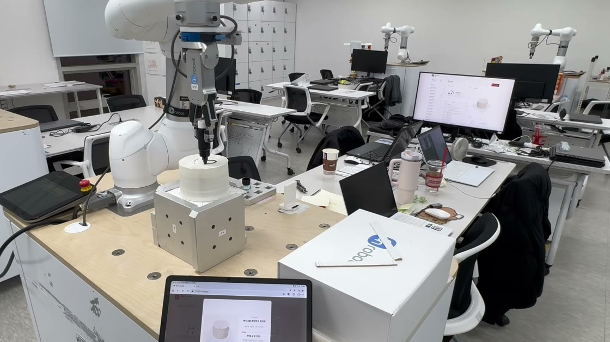
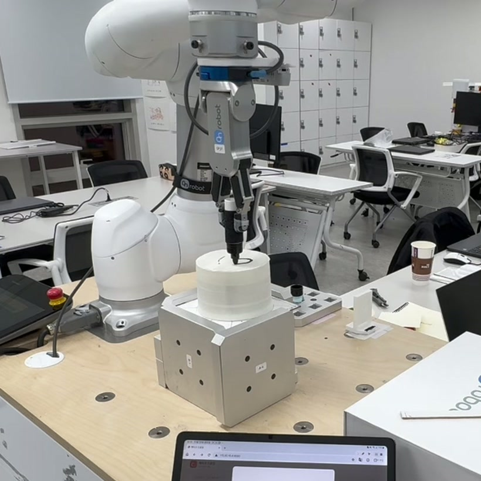
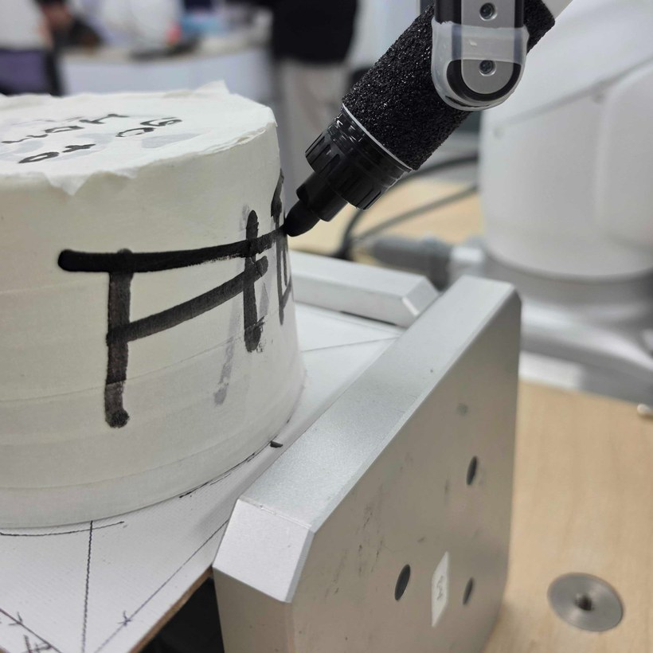
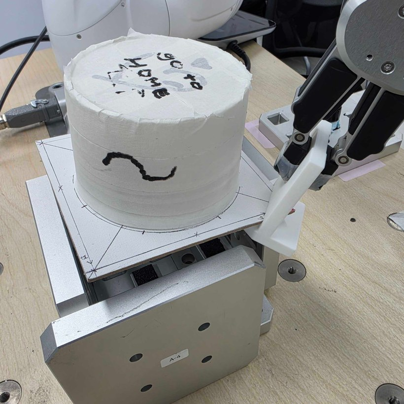
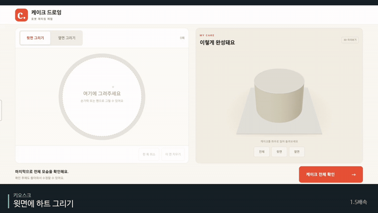
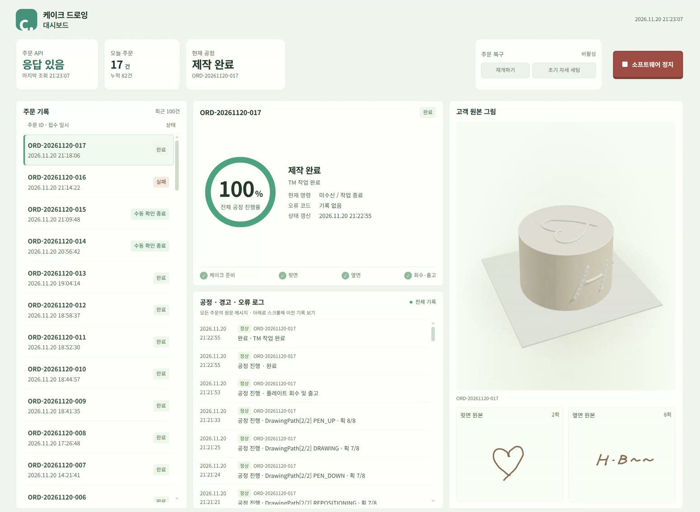
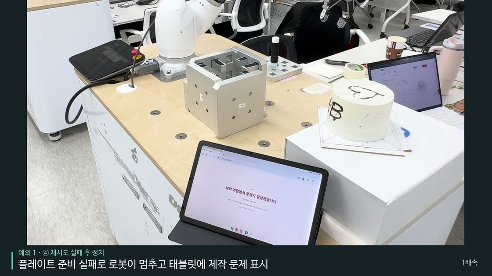
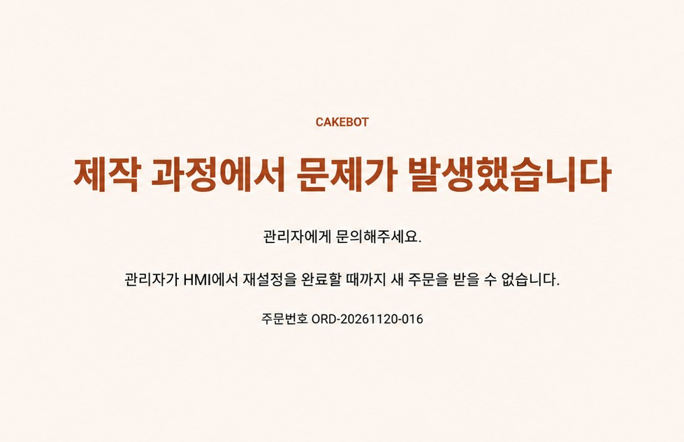
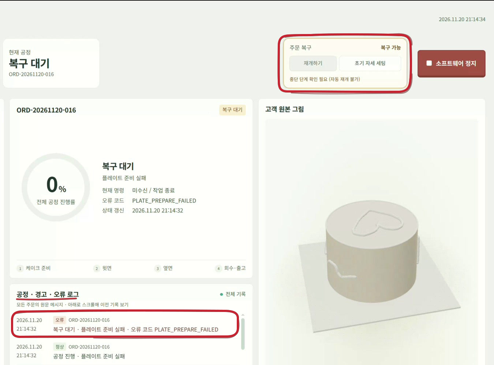

# CakeBot | 로봇 레터링 케이크

**태블릿에 그린 그림을 두산 M0609 협동로봇이 케이크 윗면과 옆면에 직접 그립니다.**

고객은 3D 미리보기에서 그림이 들어갈 위치를 확인하고 주문합니다. 로봇은 케이크를 작업대에 올리고, 표면의 모양에 맞춰 계산한 경로를 따라 그림을 그린 뒤 출고 위치로 옮깁니다. 운영자는 관리자 화면(HMI)에서 주문별 진행 상황과 오류를 확인합니다.

[시연](#시연) · [핵심 구현](#핵심-구현) · [시스템 설계](#시스템-설계) · [설치와 실행](#설치와-실행)

## 시연

### 실물 제작 시연

태블릿에서 그림을 그리는 손과 키오스크 화면을 나란히 볼 수 있습니다. 주문이 접수되면 로봇이 케이크를 작업대에 올려 윗면을 그리고, 펜을 기울여 다시 잡은 뒤 옆면을 그립니다. 영상은 윗면과 옆면 테스트를 각각 촬영해 이어 붙였습니다. [실물 공정 영상 · 1분 50초](docs/media/robot-process.mp4)

| 윗면 필기 | 옆면 필기 | 케이크 회수 |
| --- | --- | --- |
|  |  |  |

### 고객 키오스크

윗면에 하트를 그리고 옆면에 문구를 쓴 뒤, 3D 미리보기를 돌려 두 면을 확인합니다. 주문하면 화면이 제작 진행률을 보여주고, 작업이 끝나면 픽업을 안내합니다. [키오스크 영상 · 14초](docs/media/kiosk-demo.mp4)

### 관리자 HMI

주문을 선택하면 현재 작업 단계, 진행률, 공정 로그와 고객의 원본 그림을 한 화면에서 볼 수 있습니다. 영상에서는 케이크 준비부터 제작 완료까지 다섯 단계를 순서대로 따라갑니다. [HMI 영상 · 38초](docs/media/hmi-demo.mp4)

### 예외 대응

케이크판을 들어 올리는 도구(따개)가 없으면 로봇은 한 번 더 집기를 시도합니다. 두 번째도 실패하면 작업이 멈추고, 관리자가 HMI에서 복구를 확인한 뒤 제작을 다시 시작합니다. 영상에는 펜이나 케이크가 없을 때의 재시도와 별도의 소프트웨어 정지 시험도 담았습니다. [예외 대응 영상 · 1분 39초](docs/media/fault-demo.mp4)

| 키오스크의 제작 문제 안내 | HMI의 복구 대기와 오류 로그 |
| --- | --- |
|  |  |

## 핵심 구현

| 기능 | 구현 방식 |
| --- | --- |
| **양면 주문** | 윗면과 옆면을 따로 편집합니다. 한 면만 그리거나 두 면을 한 주문으로 접수할 수 있습니다. |
| **그림을 필기 경로로 변환** | 화면에서 그린 점을 케이크 위의 3D 좌표로 바꿉니다. 윗면은 원형 평면을 사용하고, 옆면은 높이에 따라 반지름을 계산합니다. 획과 획 사이에서는 펜을 들어 선이 이어지지 않게 합니다. |
| **로봇 동작 순서 제어** | 작업 관리 노드가 케이크 배치, 펜 잡기, 필기, 펜 반납, 케이크 회수를 순서대로 요청합니다. 양면 주문은 윗면을 먼저 그린 뒤 옆면용 자세로 펜을 다시 잡습니다. |
| **주문 기록과 복구** | FastAPI가 주문을 받고 SQLite에 원본 그림과 작업 상태를 저장합니다. 도구나 케이크를 잡지 못한 것으로 확인되면 해당 단계에서 한 번 더 시도합니다. 다시 실패하면 주문을 복구 대기로 기록하고 새 주문 접수를 멈춥니다. |

## 시스템 설계

### 웹 주문과 ROS 2 노드

~~~mermaid
flowchart LR
    customer["태블릿 고객 화면"] -->|"그림과 주문"| api["FastAPI"]
    api <-->|"원본과 작업 상태"| db[("SQLite")]
    api <-->|"주문 인수와 상태 보고"| bridge["ROS 주문 브리지"]
    bridge <-->|"CakeOrder 액션과 피드백"| manager["작업 관리 TM"]
    manager <-->|"GenerateTrajectory 서비스"| planner["경로 계산 DP"]
    manager <-->|"도구·필기·운반 요청과 결과"| executor["로봇 실행 RE"]
    executor -->|"이동과 그리퍼 제어"| driver["M0609·RG2 드라이버"]
    api -->|"주문·공정·로그 조회"| hmi["관리자 HMI"]
~~~

주문 브리지가 웹에서 받은 그림의 픽셀 좌표와 케이크 정보를 ROS 2에 전달합니다. 작업 관리 노드(TM)가 공정 순서를 정하면 경로 계산 노드(DP)가 면별 필기 경로를 계산하고, 로봇 실행 노드(RE)가 팔과 그리퍼를 움직입니다. 작업 상태는 브리지를 거쳐 서버에 반영됩니다. [시퀀스와 상태 흐름](docs/architecture/SYSTEM_DESIGN.md) · [그림 데이터 규격](docs/DRAWING_PROTOCOL.md)

### 주문 한 건의 제작 흐름

~~~mermaid
flowchart TD
    draft["윗면·옆면 편집과 3D 확인"] --> submit["그림 검증과 주문 저장"]
    submit --> load["케이크를 작업대에 배치"]
    load --> top{"윗면 그림이 있는가?"}
    top -->|"있음"| drawTop["윗면 펜 파지와 필기"]
    top -->|"없음"| side
    drawTop --> side{"옆면 그림이 있는가?"}
    side -->|"있음"| drawSide["옆면 자세로 펜 파지와 필기"]
    side -->|"없음"| unload
    drawSide --> unload["펜 반납과 케이크 회수·출고"]
    unload --> done["주문 완료 기록"]
~~~

실물 제작에서는 주문에 그림이 있는 면만 그립니다. 두 면 모두 요청하면 윗면부터 그리고, 필기를 마치면 도구를 반납한 뒤 케이크를 출고 위치로 옮깁니다. [표면 좌표 변환](docs/SURFACE_DRAWING.md) · [공정과 예외 처리 기록](docs/HMI_OPERATION.md)

## 운영 환경과 장비

| 구분 | 구성 |
| --- | --- |
| 운영체제 | Ubuntu 24.04 LTS |
| 고객·관리자 화면 | Node.js 22.12 이상, React, TypeScript, Vite, Three.js |
| 서버·저장 | Python 3.12, FastAPI, Pydantic, Uvicorn, SQLite |
| 로봇 소프트웨어 | ROS 2 Jazzy, colcon, Doosan ROS 2 드라이버, OnRobot RG2 드라이버 |
| 가상 실행 | Docker에서 구동하는 가상 DRCF, RViz2 |
| 제어 장비 | 두산 M0609 협동로봇, OnRobot RG2 그리퍼, 티칭 펜던트 |
| 작업 도구 | 레터링 펜과 거치대, 케이크판 집기 도구, 케이크 고정구와 작업대 |
| 입력·운영 장비 | 고객 태블릿, 운영 노트북, 로봇용 유선 LAN, 태블릿용 Wi-Fi |

Python 서버, 웹 화면, ROS 패키지의 의존성은 각 환경의 설정 파일에서 관리합니다. ROS 패키지는 `package.xml`에 필요한 패키지를 명시합니다. [Python requirements.txt](backend/requirements.txt) · [웹 package.json](frontend/package.json) · [웹 package-lock.json](frontend/package-lock.json)

## 설치와 실행

### 1. 새 PC에서 준비

Ubuntu 24.04에 ROS 2 Jazzy와 Node.js 22.12 이상을 설치한 뒤 아래 명령을 실행합니다. 가상 모드를 쓸 경우 현재 사용자 계정에서 Docker를 실행할 수 있어야 합니다.

~~~bash
git clone https://github.com/seng3340-oss/Rokey_10_A_3.git
cd Rokey_10_A_3

source /opt/ros/jazzy/setup.bash
sudo apt install python3-colcon-common-extensions python3-rosdep \
  python3-venv python3-pymodbus python3-numpy python3-scipy python3-yaml

# rosdep을 처음 사용하는 PC에서는 먼저 sudo rosdep init을 한 번 실행합니다.
rosdep update
rosdep install --from-paths ws_dsr/src ws_cobot1/src --ignore-src -r -y
bash scripts/setup_project.sh
~~~

준비 스크립트는 웹 의존성을 설치하고 Python 가상환경을 만든 다음, `ws_dsr`의 드라이버와 `ws_cobot1`의 작업 패키지를 차례로 빌드합니다. [로봇 환경 구성](docs/ROBOT_ENVIRONMENT.md)

### 2. 실행 모드 선택

| 모드 | 실행 명령 | ROS 2 launch |
| --- | --- | --- |
| 가상 드로잉 | `bash scripts/start_virtual.sh` | `cake_workcell_bringup virtual.launch.py` |
| 실제 전체 공정 | `bash scripts/start_real.sh` | `m0609_rg2_bringup bringup.launch.py` (`mode:=real`) |

두 스크립트에 `--check`를 붙이면 의존성과 포트, 설정을 먼저 확인할 수 있습니다. 전체 실행 순서는 다음과 같습니다.

1. 로봇 드라이버와 컨트롤러를 시작합니다. 가상 모드의 기본 펜 돌출 길이는 4cm입니다. 실제 모드는 `config/real_robot.json`에서 작업 기준점을 읽습니다.
2. FastAPI 서버와 주문 저장소를 준비합니다.
3. 경로 계산(DP), 로봇 실행(RE), 작업 관리(TM) 노드를 차례로 시작합니다.
4. 주문 브리지와 웹 화면을 시작하고 접속 주소를 출력합니다.

실제 모드를 실행하기 전에 작업대 배치, 펜촉 TCP와 현장 설정을 확인합니다. 실제 모드에서는 제작 요청이 들어오면 로봇이 움직입니다. [가상 작업셀 실행과 배치](ws_cobot1/doc/VIRTUAL_WORKCELL.md) · [태블릿 네트워크 연결](docs/NETWORK.md)

### 3. 웹 접속과 종료

| 화면 | 기본 주소 |
| --- | --- |
| 고객 화면 | `http://localhost:8080/` |
| 관리자 HMI | `http://localhost:8080/hmi` |
| 고객·관리자 화면 나란히 보기 | `http://localhost:8080/workspace` |

태블릿이 운영 노트북과 같은 Wi-Fi에 연결되어 있으면, 주소의 `localhost`를 노트북의 Wi-Fi IP로 바꿔 접속합니다. 종료하려면 실행한 터미널에서 `Ctrl+C`를 누릅니다.

## 설계·검증 자료

- [시스템 설계와 ROS 통신 규격 PDF](docs/architecture/report/케이크_시스템설계_통신규격_v0.3.pdf) · [인터페이스 결정 기록](docs/architecture/DECISIONS.md)
- [윗면·옆면 통합과 현장 보정 기록](docs/TOP_SIDE_INTEGRATION.md)
- [장비 없는 웹·백엔드·ROS 연동 검사](docs/TESTING_HMI.md)
