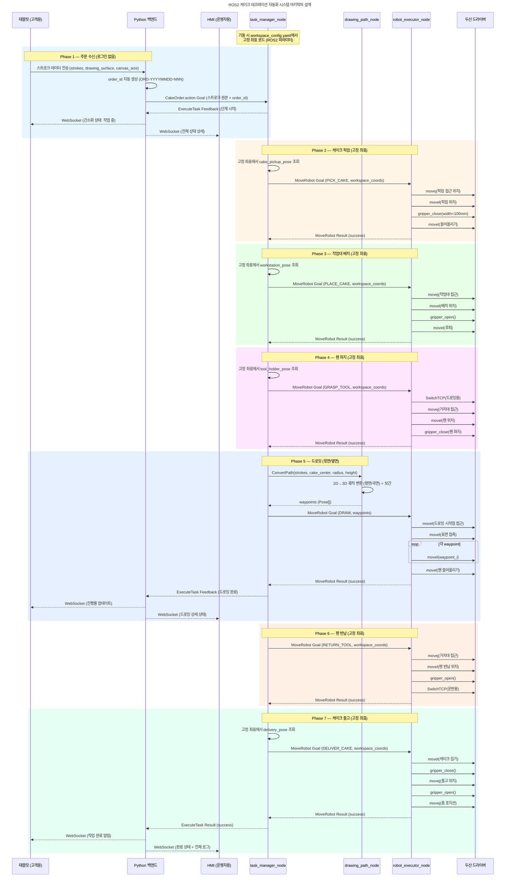
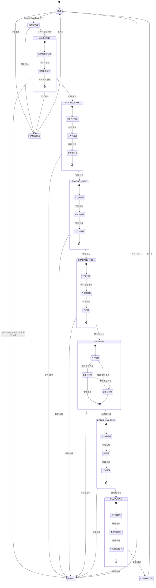

# 케이크 자동화 시스템 설계 기준

PM이 공유한 전체 시퀀스와 작업 상태 흐름도를 보관합니다.
출처는 [소은님 시스템 설계 초안](https://app.slack.com/archives/C0CGDTN7BPE/p1794651834002869)과
프로젝트 대화에 전달된 다이어그램입니다. 아래는 **목표 설계이며 현재 실행 흐름이 아닙니다.**

원문의 이름·단계는 보존했습니다. 상세 정의와 다른 Action/Service 이름,
진행 중 취소와 자동 복귀 등 구현 전 확인 항목은 [인터페이스 작업 기준](INTERFACES.md)에 정리했습니다.
현재 구현은 웹 주문 저장·가상 배치와 인터페이스 타입 생성까지입니다.

## 전체 시퀀스

## 작업 상태 흐름

도식의 자동 홈 복귀·취소 전이는 구현 코드가 아닙니다. 실행 중 취소 확인과 파지 상태에 따른 복구는 별도 설계가 필요합니다.
두산/RG2 호출이 한 DRV로 표현됐지만 실제 실행 코드는 두산·OnRobot 드라이버를 구분해야 합니다.
